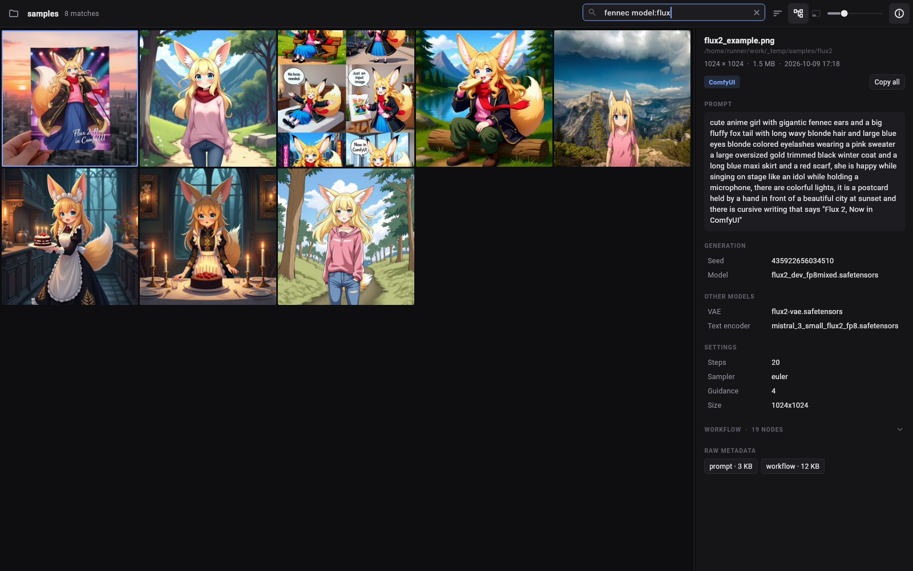
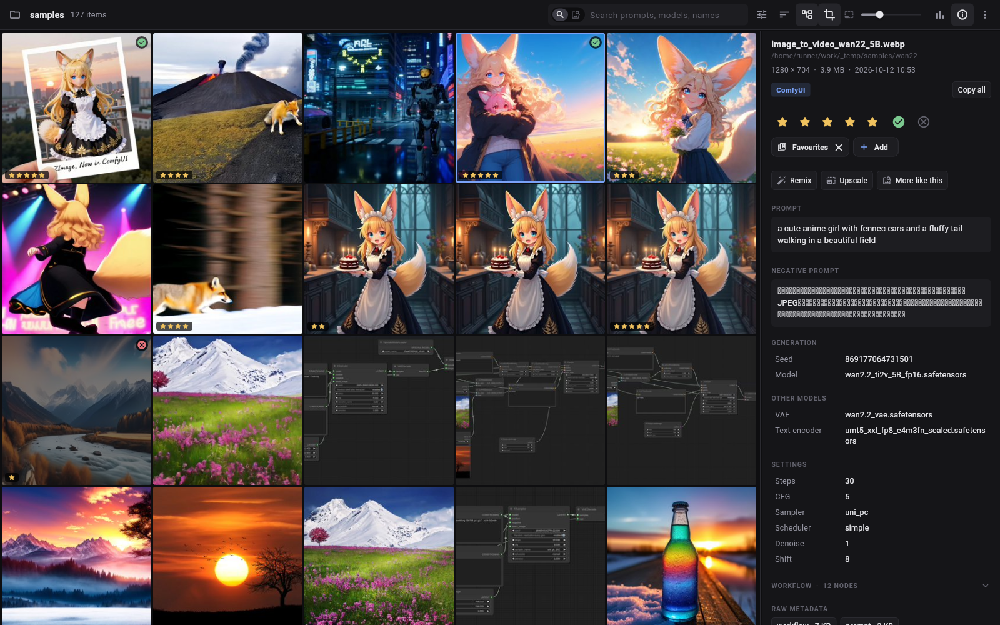
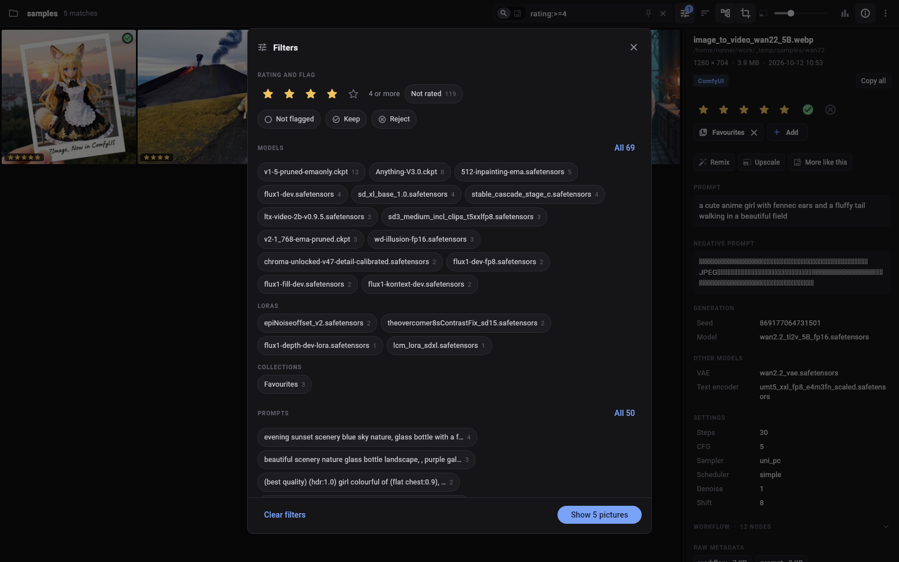
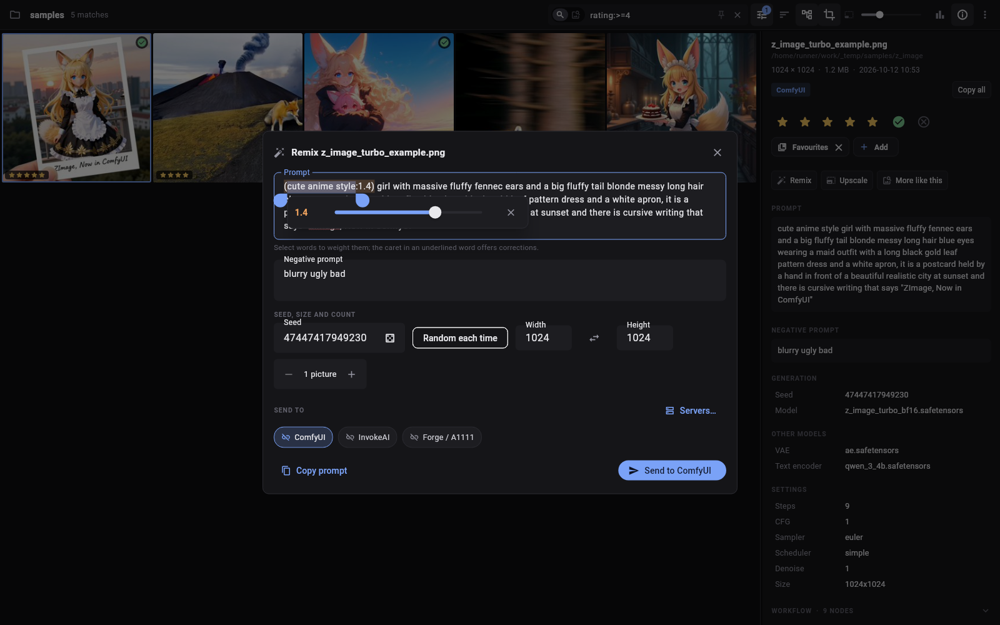
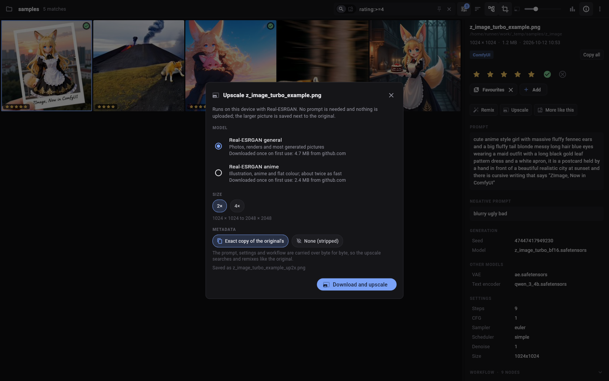
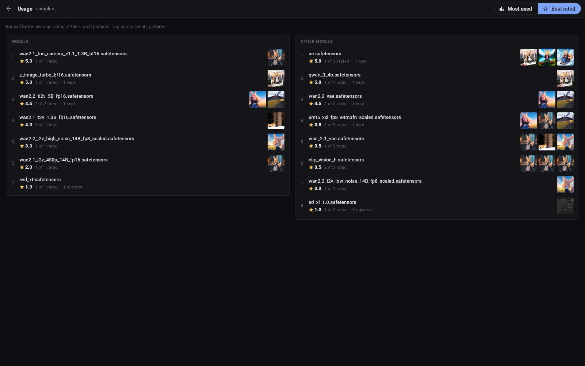
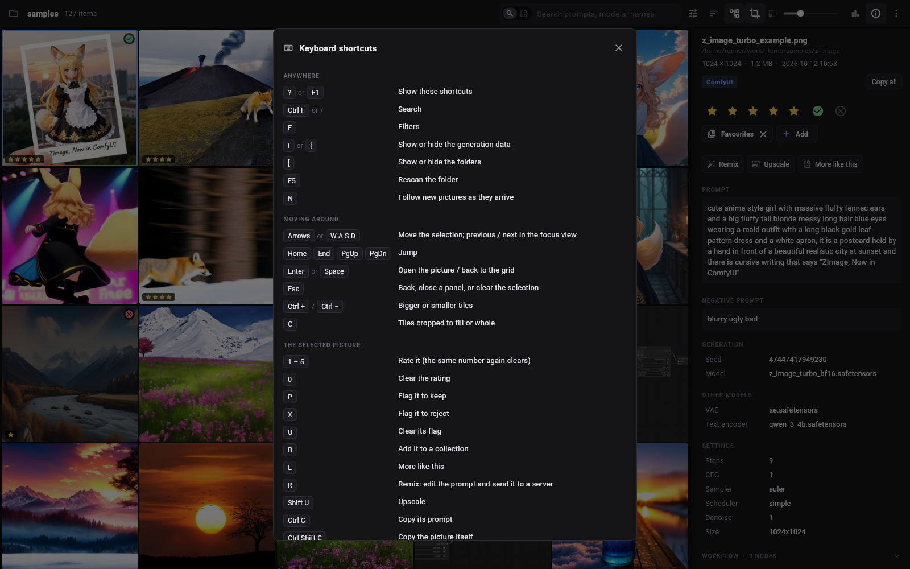

# GenerativeView

A fast image browser for folders of AI-generated images, for Linux, Windows, macOS and Android.

Point it at an output folder and it shows a resizable grid of everything in it, reads the generation metadata out of each file (ComfyUI, InvokeAI, A1111/Forge), and lets you search the folder by prompt, model, LoRA, seed or file name. Tap any value to copy it; press and hold one to see every image that shares it.



## What it does

- **Grid** of images and videos from a folder and, optionally, its sub-folders. Resize tiles with the slider, pinch, `Ctrl` + scroll or `Ctrl` `+`/`-`. The crop button (or `C`) switches tiles between cropped-to-fill and showing the whole image.
- **Focus view**: double tap (or `Enter` / `Space`) opens one image; swipe or use the arrow keys to move through the folder; pinch or turn the scroll wheel to zoom; double tap (or `Enter` / `Space` / `Esc`) to go back.
- **Zoom** is measured against the image's real size and moves in steps of 10 %: each notch of the wheel goes to the next multiple of ten, and a pinch settles on the nearest one when you let go. A chip shows the percentage while you zoom; it turns blue, and stays, at exactly 100 % (one image pixel per screen pixel). The size at which the image just fits the window is a stop too. You can zoom out as far as that, or as far as 100 % when fitting the window means enlarging the image. You can zoom in as far as 400 %, or as far as the fitted size when that is larger still.
- **Metadata panel** on the right for the selected image: prompt, negative prompt, seed, model, LoRAs with weights, other models (VAE, text encoders, ControlNet, upscalers), sampler settings, the full ComfyUI node graph, and the raw JSON exactly as stored. Tap a value to copy it. "Copy as tags" gives `<lora:name:weight>`; "Copy all" gives every field as text.
- **Filter by what an image used**: right-click, or press and hold, the seed, a model, a LoRA or a sampler setting in the metadata panel and choose "Show only images…". On the **LoRAs** heading that means every image that uses all of the LoRAs listed, at any strength; on a single LoRA, every image that uses that one. The filter appears in the search box as ordinary search text, so it can be edited, cleared or pinned.
- **Search** across the folder as you type. It finds whole words in prompts (`fox` is not `foxglove`), and names of files, models and LoRAs that start with what you typed. The best matches come first: see [Search syntax](#search-syntax).
- **Content search**: the switch at the left end of the search box goes from searching the metadata (the magnifying glass) to describing what you are looking for (the magnifying glass over a picture): `a fox in the snow` then finds pictures that *show* that, whatever their prompts say. Only pictures that match are listed, the best match first. It needs a model (TinyCLIP, 337 MB), which the app offers to download the first time and then runs on your device; see [Content search](#content-search) below. Click the switch again to go back.
- **Room to type**: while you are typing in it the search box grows over the folder's name and shrinks back when you are done; the count of matches stays in view beside it. Where the bar is too short for that to gain much (a tablet held upright, a narrow window) it takes the whole bar instead, tools included, until you press Enter or tap elsewhere. That, the search switch and the two panels move into place over a fifth of a second, or at once where the system is set to reduce motion.
- **Pinned searches**: type a search and click the pin beside the ✕ to keep it. Clicking in the search box lists your pinned searches underneath; click one to run it, or its ✕ to remove it. Typing narrows the list to the pins that contain what you typed.
- **Usage** (the bar-chart button; in a narrow window it is in the sort menu): which models, LoRAs, samplers, schedulers, step counts, CFG values, sizes and prompt words the folder's images use most, how each one's use is spread over time, and a timeline of images per day, week, month or year. Click anything to go back to the grid showing only the images behind that number.
- **Ratings, flags and collections**: give a picture one to five stars (keys `1`–`5`, or the stars in the metadata panel), flag it to keep (`P`) or reject (`X`), and put it in any number of collections (`B`). Stars and flags show on the tiles; rejected pictures fade back. They are saved in a small `.generativeview.json` file in each picture's own folder, not inside the app, so a folder synced between machines carries them along: rate on the tablet, see the stars on the desktop. Edits made elsewhere show up as soon as the file changes. Collections are listed in the folder panel; tap one to see its pictures. See [Notes files](#notes-files).
- **Filters** (the sliders button, or `F`): every model, LoRA, collection, prompt, prompt word, sampler, scheduler, step count, CFG, size and tool the folder's pictures used, with how many each, as chips to tap; plus a minimum star rating and keep / reject. Chips in one group widen the selection (this model or that one), groups narrow it (this model and that sampler). The filters are written into the search box as ordinary search text, so a typed search and filters work together, and the whole thing can be pinned. The button shows how many filters are on.
- **Filter by prompt** like any other value: right-click or press and hold the prompt (or the negative prompt) in the metadata panel and choose "Show only images with this prompt".
- **More like this** (`L`, or from the image menu or the metadata panel): the pictures that look like the selected one, most alike first, using the content-search model. It can be combined with any other search, `rating:4+ similar:"…"`.
- **Remix** (`R`): the picture's prompt and negative prompt in an editor, with its seed (or a random one each time), size and a count, and a button that queues them on **ComfyUI**, **InvokeAI** or **Forge / A1111**. ComfyUI and InvokeAI get the picture's own workflow with those values changed in place when it carries one; a picture from another program gets a standard text-to-image workflow built from its settings instead (the same model and LoRAs, matched by name against what that server has installed, with its prompt, seed, steps, CFG, sampler and size; InvokeAI builds for SD 1.x, SD 2.x and SDXL). Forge gets the settings as values. So any picture with generation data can go to any of the three. Server addresses are set once, under ⋮ › Generation servers, each with a Test button. Nothing is sent until Send is pressed. While a remix is out, a blue **Remix Running** chip moves at the top of the grid (in the top bar in the focus view); as each comes back a **Remix Done** chip appears beside it (**3 Remixes Done** when several are waiting), and tapping that opens the **Remixes** collection with the new pictures picked out by a short animation. Every remix is saved beside its original as `name_remix1.png` and put in the **Remixes** collection, which is made the first time.
- **Prompt editor**: spelling is checked as you type, with corrections offered when the caret is in an underlined word (or on right-click). It knows an English word list, the words of prompts (`bokeh`, `sdxl`, `isometric`), every word used in two or more of the folder's prompts, and words you add. **Select a word or several and a slider appears under them** for their weight: drag it and the words become `(words:1.2)`, anywhere from 0.1 to 2.0 in steps of 0.05, starting from 1.0. With the caret inside a weighted group, the slider edits that group; the cross takes the weight off. `Ctrl` `↑` / `↓` nudge the weight by a step, as in ComfyUI. Weighted words are tinted, warmer the heavier.
- **Upscale** (`Shift` `U`): on the device, with no server and no upload. Pick Real-ESRGAN *general* (photos, renders) or *anime* (illustration, flat colour), 2× or 4×. The result is saved beside the original as `name_up2x.png` with **either an exact copy of the original's metadata** (its PNG text chunks, JPEG EXIF/XMP/comment segments or WebP EXIF/XMP chunks, byte for byte, so the upscale searches and remixes like the original) **or none at all**. These models need no prompt. Each model is a one-time download of 2.5 or 4.9 MB from the Real-ESRGAN releases on github.com. See [Upscaling](#upscaling).
- **New pictures** that arrive while a folder is open get a blue dot and a "3 new pictures" button over the grid that jumps to them. **Follow new pictures** (`N`, or ⋮) goes further and selects each one as it lands, in the focus view too, so the app can sit on a second screen while you generate.
- **Best rated** (on the usage page): models and LoRAs ranked by the average stars of their rated pictures, with how many are rated, kept and rejected, and their best three pictures.
- **Look up on Civitai**: right-click a model or LoRA in the metadata panel. By the hash A1111 and Forge save (the exact file), or else by file name, it shows the base model, the trigger words (tap to copy) and a link to its page. Only the hash or name is sent, and only when asked.
- **Keyboard shortcuts**: `?` or `F1` lists them all.
- **Image menu**: right-click, or press and hold, an image in the grid or the focus view. **Copy image** puts the file itself on the clipboard, bytes untouched, so the generation data goes with it wherever you paste. The menu also copies the prompt and the file path.
- **Live**: images that appear, change or disappear while the folder is open show up in the grid and in search on their own.
- **Folder panel** on the left: a lazily loaded tree, plus a box to paste a path into.
- **Pinned folders**: right-click, or press and hold, any folder and choose "Pin this folder". Pinned folders are listed in a section at the top of the panel, under the path box, and wear a filled blue folder icon there and in the tree. Click one to jump to it; the same menu unpins it. Click the section's heading to fold it away.

| | |
| --- | --- |
|  |  |
| Ratings, flags and collections, saved beside the pictures | Filters, with counts |
|  |  |
| Remix: select words, drag their weight | Upscale on the device, metadata kept or stripped |
|  |  |
| Best rated models and LoRAs | `?` lists every shortcut |

Both panels collapse; on narrow screens they slide over the grid instead of sitting beside it. When the window is taller than it is wide — a tablet held upright, a window tiled to half the screen — the metadata panel moves under the grid or the focused image as a footer, with a top edge you can drag to resize it.

### Search syntax

| Type | Finds |
| --- | --- |
| `red fox` | images whose metadata has both words, `red` and `fox` |
| `"red fox"` | the exact phrase |
| `fox -snow` | `fox` but not `snow` |
| `fox*` | words that start with `fox`: `foxes`, `foxglove` (also `*fox` for words that end with it, `*fox*` for any that contain it) |
| `model:flux` | model name contains `flux` (also `lora:`, `name:`) |
| `prompt:fox` | the word `fox` in the prompt (also `neg:` for the negative prompt) |
| `seed:1234` | seed starts with `1234` |
| `source:comfyui` | made with that tool (`invokeai`, `a1111`, `forge`, …) |
| `sampler:euler` | sampler name contains `euler` (also `scheduler:`) |
| `steps:30` | exactly 30 steps (also `cfg:7`, where `7` and `7.0` are the same) |
| `size:1024x1024` | image dimensions contain `1024x1024` |
| `date:2026-10` | file dated that month (also `date:2026-10-09`, `date:2026`, and `date:2026-10-01..2026-10-07` for a range) |
| `rating:4` | exactly four stars (also `rating:4+` or `rating:>=4`, `rating:<3`, `rating:2..4`, `rating:none` for unrated, `rating:any`) |
| `flag:keep` | flagged to keep (also `flag:reject`, `flag:none`, and `flag:keep\|none`) |
| `collection:fox` | in a collection whose name contains `fox` (`collection:="Night city"` for that one) |
| `fullprompt:="a red fox"` | that whole prompt, give or take case and spacing (also `fullneg:` for the negative prompt) |
| `similar:"/path/to/a.png"` | pictures that look like that one, most alike first |

Matching is case-insensitive, and in prompts it is by whole word: `fox` finds `a red fox`, `fox's` and `red_fox`, but not `foxglove` or `firefox`, and `lond` does not find `blonde` (`*lond*` does). Names are not made of words in the same way, so in the names of files, models and LoRAs a search only has to start where a word starts: `flux` finds `flux1-dev.safetensors` and `dev` does too, but `lux` does not. The fields that name one of those (`model:`, `lora:`, `name:`, `sampler:`) match any part of it.

**Best match first.** While you are searching, results are ordered by how well they match rather than by date:

1. images with the words in their prompt: first those where the words you typed stand together, then by how early the prompt gets to them and how often it repeats them;
2. images that only have them in a file, model or LoRA name, and then in a setting;
3. images that only have them in the negative prompt.

Equally good matches, and searches where nothing can match better or worse (`model:=…`, `date:…`), stay in the folder's own order. The sort menu offers **Best match first** whenever there is a search; pick another order there and searches keep it until you switch back.

Put `=` after the colon to match a whole value instead of part of one. This is what the "Show only images…" menus and the usage page write for you:

| Type | Finds |
| --- | --- |
| `seed:=1234` | that seed and no other |
| `model:="flux1-dev.safetensors"` | images made with exactly that model, whatever it was used as |
| `lora:=detail_xl lora:=inkwash` | images that use both LoRAs, at any strength |
| `sampler:=euler`, `size:=1024x1024`, `name:=a.png` | the whole sampler name, size or file name |
| `model:="flux1-dev.safetensors\|sdxl_base.safetensors"` | either model: `\|` between whole values means any of them |

### Content search

Content search uses a CLIP model: a network that turns a picture and a description into numbers that agree when one matches the other. GenerativeView uses [TinyCLIP ViT-40M/32](https://huggingface.co/wkcn/TinyCLIP-ViT-40M-32-Text-19M-LAION400M) (MIT licence): about half the size and half the arithmetic of the original CLIP ViT-B/32, for somewhat lower accuracy (59.8 % against 63.3 % on the usual ImageNet zero-shot test).

- **The model is not in the app.** The first time you switch content search on, a banner offers to download it: three files, 337 MB, from huggingface.co into the app's data folder (`models/tinyclip-vit-40m-32-text-19m`). The pictures and what you type never leave the device. (The app's other uses of the network are the upscale models, a Civitai lookup when you ask for one, and sending a remix to your own servers.) On Android this is what the app's network permission is for. To do without it, copy `config.json`, `tokenizer.json` and `model.safetensors` from that page into the folder yourself.
- **Pictures are looked at once.** With content search on, the app works through the open folder in the background, newest pictures first, and remembers what it saw in `vectors.db` beside the index (about 1 KB per picture). Searches answer from whatever has been looked at so far and fill in as the rest is done. It uses half the machine's cores and the small thumbnails the grid already made. On one core of a cloud VM a picture took 65 to 80 ms; a tablet will be slower, so a first pass over thousands of pictures there takes a while.
- **What you get back** is the pictures that match, best match first, and nothing when none does. The model's scores have no fixed scale, so each picture is measured against itself: the app scores it against a few hundred everyday words (`woman`, `forest`, `sword`, `car`…, in `core/src/clip/everyday.txt`), most of which are *not* in any given picture, and a description matches when it scores well clear of that ordinary run.
- **It is still a judgement, not a lookup.** The model is good at what a picture is of, and weak at small details, counting and text. In a folder where every picture is of much the same thing it tells them apart poorly: it can say "a person, not a landscape" far more reliably than which detail of the person is in view. So a search can miss a picture where the thing is small, and can include one that only resembles it. Where the bar sits is one constant, `CLEAR` in `core/src/clip/mod.rs`, set from measurements on a real library; `cargo run --release --example content_probe -- ~/.local/share/com.jrufer.generativeview "/your/folder"` prints the same measurements for a library you have already searched, using its prompts as a rough answer key.
- A pinned search remembers which kind it is, and "Show only images…" filters always switch back to the metadata search.

The model runs on the CPU in the Rust core (`core/src/clip`): no GPU, no extra libraries. Its arithmetic is checked in the tests against the reference implementation in Hugging Face's `transformers` on a small model with made-up weights (`core/tests/fixtures/clip_mini`).

### Keyboard

| Key | Grid | Focus view |
| --- | --- | --- |
| Arrows, `W` `A` `S` `D` | move selection | previous / next image |
| `Enter`, `Space` | open image | back to grid |
| `Esc` | clear selection | back to grid |
| `Home` / `End`, `PgUp` / `PgDn` | jump | jump |
| `Ctrl` `F` or `/` | search | |
| `Ctrl` `C` | copy the selected image's prompt | same |
| `Ctrl` `Shift` `C` | copy the selected image itself | same |
| `Ctrl` `+` / `-` | tile size | |
| `I` or `]` | toggle metadata panel | same |
| `[` | toggle folder panel | |
| `C` | thumbnails cropped to fill / whole image | |
| `F5` | rescan the folder | |
| `1`–`5`, `0` | rate the selection (the same number again clears), clear | same |
| `P` / `X` / `U` | flag to keep / reject / clear the flag | same |
| `B` | add to a collection | same |
| `L` | more like this | same |
| `R` | remix | same |
| `Shift` `U` | upscale | same |
| `F` | filters | |
| `N` | follow new pictures | same |
| `?` or `F1` | list every shortcut | same |

In the prompt editor, `Ctrl` `↑` / `↓` change the weight of the selected words.

### Metadata it reads

| Tool | Where it looks |
| --- | --- |
| ComfyUI | `prompt` / `workflow` PNG chunks; EXIF in WebP and JPEG; tags in MP4, MOV and WebM (ComfyUI's own video nodes and VideoHelperSuite) |
| InvokeAI | `invokeai_metadata` (v3 and later) and `sd-metadata` (v2) |
| A1111 / Forge | `parameters` PNG chunk; EXIF UserComment in JPEG and WebP |
| Also | SwarmUI, Fooocus and NovelAI basics. Anything unrecognised still appears under "Raw metadata". |

ComfyUI has no fixed schema, so prompts and settings are found by walking the graph back from the sampler. That handles custom samplers, ControlNet, prompt-concatenation and primitive nodes, rgthree's Power Lora Loader and similar; an unusual custom node may still be missed. The full node list and raw JSON are always there to fall back on.

### Notes files

Ratings, flags and collections are kept in a file called `.generativeview.json` in each folder that has any, beside the pictures they are about:

```json
{
  "generativeview": 1,
  "images": {
    "ComfyUI_00012_.png": { "rating": 4, "flag": "keep", "collections": ["Night city"] }
  }
}
```

The file is small, readable, and written whole (to a temporary file that is then renamed over it), so a sync tool such as Syncthing never sees half of one. Every change reads the file first and changes only the pictures it is about, so notes made on two machines are merged rather than lost, and anything else in the file (fields from a newer version, or another tool) is kept as it is. A picture with no stars, flag or collections has no entry; a folder with none has no file. The app keeps a copy in its index for searching, which it rebuilds from the files whenever they change.

### Upscaling

The upscaler is Real-ESRGAN's compact model (SRVGGNetCompact, BSD-3-Clause), run on the CPU by the Rust core (`core/src/sr`), which reads the project's own `.pth` files directly: a small zip-and-pickle reader that understands state dicts and refuses anything else, so nothing in the file is ever run. Its output is checked against an independent NumPy implementation of the same network, to within one level in 255 (rounding).

A picture is upscaled in 160-pixel tiles with a 12-pixel margin that is thrown away, so tiles meet without seams; each layer is one matrix multiplication per tile, using all cores. On two cores of a cloud VM a 256 × 256 picture took six seconds at 4×; a desktop with more cores is proportionally quicker, a tablet slower. 2× is the 4× result brought down with Lanczos, which keeps the detail the model added. Transparency is enlarged plainly alongside. Upscales run in the background with a progress bar in the corner and can be stopped; the file appears in the grid when it is done. `cargo run --release --example upscale_check -- MODEL.pth in.png out.png` runs one from the command line.

## Install

Every merge to `main` is built, tested and published under [Releases](https://github.com/JRufer/GenerativeView/releases) as `build-<n>`. Grab the newest:

- **Linux**: `GenerativeView-x86_64.AppImage`. Make it executable and run it:

  ```sh
  chmod +x GenerativeView-x86_64.AppImage
  ./GenerativeView-x86_64.AppImage            # or: ./GenerativeView-x86_64.AppImage /path/to/folder
  ```

  `generativeview-linux-x64.tar.gz` is the same app as a plain folder; run `bundle/install.sh` to install it under `~/.local` with a menu entry.

- **Android**: `GenerativeView-arm64-v8a.apk` for tablets and phones. Sideload it.

**Linux**: the AppImage runs on Ubuntu 22.04, Debian 12, Arch / CachyOS and anything newer (x86_64), on Wayland or X11. It needs GTK 3, which desktops already have, and `ffmpeg` for video thumbnails. It plays video with the system's `mpv` library when there is one and brings its own when there isn't. The `.tar.gz` folder doesn't bring one, so with it install `mpv` too. On CachyOS / Arch:

```sh
sudo pacman -S --needed gtk3 mpv ffmpeg
```

On Ubuntu / Debian: `sudo apt install ffmpeg` (and `mpv` for the `.tar.gz`).

**Android**: on first launch tap **Allow access** and turn on "All files access" for GenerativeView; it needs real folder paths to scan and watch, which Android only gives through that permission. (That permission is also why this is a sideload app rather than a Play Store one.)

### Signing key

Android only installs an update over an existing app if both are signed with the same key. Until the repository has a key of its own, each CI run signs with a throwaway one, and you have to uninstall before installing a newer build. To fix that once:

```sh
keytool -genkeypair -keystore generativeview.jks -storetype PKCS12 -alias generativeview \
  -keyalg RSA -keysize 2048 -validity 10000 -dname "CN=GenerativeView" -storepass 'choose-a-password'

base64 -w0 generativeview.jks | gh secret set ANDROID_KEYSTORE_BASE64 --repo JRufer/GenerativeView
gh secret set ANDROID_KEYSTORE_PASSWORD --repo JRufer/GenerativeView --body 'choose-a-password'
```

Keep `generativeview.jks` somewhere safe and out of the repository. Builds from then on all carry that signature.

## Build from source

You need Flutter 3.47 or newer and a Rust toolchain.

### Linux

```sh
sudo pacman -S --needed clang cmake ninja pkgconf gtk3 mpv ffmpeg rustup   # CachyOS / Arch
flutter build linux --release      # also runs `cargo build --release` for the core
tool/install-linux.sh              # optional: install to ~/.local with a menu entry
tool/build-appimage.sh             # optional: wrap the bundle as a single-file AppImage
```

`generativeview /path/to/folder` opens that folder directly.

### Windows

```sh
flutter build windows --release    # CMake automatically builds gvcore.dll
```

The release bundle is produced in `build/windows/x64/runner/Release/` with `generativeview.exe` and `gvcore.dll`.

### macOS

```sh
tool/build-macos-core.sh           # builds universal (arm64 + x86_64) libgvcore.dylib
flutter build macos --release
```

The release bundle is produced in `build/macos/Build/Products/Release/generativeview.app`.

### Android

```sh
rustup target add aarch64-linux-android
cargo install cargo-ndk
export ANDROID_NDK_HOME=/path/to/android-sdk/ndk/<version>

tool/build-android-core.sh arm64-v8a          # builds libgvcore.so into android/app/src/main/jniLibs
flutter build apk --release --split-per-abi
```

Run `tool/build-android-core.sh` again whenever something under `core/` changes.

## How it works

```
lib/        Flutter UI (Dart)
core/       Rust library: metadata parsing, index, file watching, thumbnails, content search
```

The UI talks to the core through a small hand-written `dart:ffi` layer (`lib/src/core/native_core.dart` ↔ `core/src/ffi.rs`). Every call is asynchronous, so the UI thread never waits on disk.

- **Metadata** is read without decoding pixels: the core walks the file's chunk or box structure and pulls out the text. Indexing ten thousand PNGs for the first time took about a second on a two-core test machine; reopening the folder took under a tenth of a second.
- **The index** is one SQLite file holding a row per image and its lower-cased search text. Opening a folder answers from the index at once, then compares it with the disk and parses only what is new or changed.
- **Live updates** come from file-system notifications, with a cheap check of folder timestamps every few seconds as a backstop for storage that sends none (Android shared storage, network mounts).
- **Thumbnails** are generated in two sizes on demand, newest request first, and cached on disk. Requests for tiles that scrolled away are dropped. The rest of the folder is pre-rendered in the background at low priority.
- **Grid data** crosses to Dart as one packed buffer that is read in place, so listing ten thousand items costs no parsing.
- **Content search** keeps one vector per picture, filed under the picture's path, date and size like a thumbnail. A search embeds the description (about 20 ms) and takes one dot product per picture. What is ordinary for a picture (its scores against the everyday words) is worked out the first time it is searched in a session and kept in memory: about a quarter of a second for 1,500 pictures on two cores, model loading included.
- **Whole words and best match** are two small SQL functions in the core, run only over the images whose text contains what was typed at all: searching ten thousand images and ordering them takes about 10 ms on the same test machine.
- **Exact filters and usage counts** read one more text column beside the search text: a line per model, LoRA and setting. Counting what ten thousand images were made with is one pass over it (about 35 ms on the same test machine), and indexing is no slower for it.

The index lives in `~/.local/share/com.jrufer.generativeview` and thumbnails in `~/.cache/com.jrufer.generativeview` (on Android, in the app's own storage). The thumbnails and the image index are caches of what is on disk and are rebuilt if deleted; so is `vectors.db`, though rebuilding it means looking at every picture again. The index file also holds your settings, pinned folders and pinned searches, so deleting it resets those.

## Development

```sh
cd core && cargo test                                    # parsers, index, watcher, thumbnails
cargo run --release --example dump -- image.png          # print what the core reads from a file
cargo run --release --example bench -- /path/to/folder   # time indexing, search and thumbnails
cargo run --release --example content_probe -- DATA DIR  # how content search rates a library (see above)

(cd core && cargo build --release) && flutter test       # the real UI against the real core
xvfb-run -a flutter test integration_test -d linux       # the built app in a virtual display
```

`flutter test` drives the actual app against the actual Rust library on a folder of generated images: it searches, opens the metadata panel, copies values, steps through the focus view and checks that added and deleted files appear and disappear. CI runs the same flow against the built Linux app in a virtual display and against the APK on an emulated Android tablet (`tool/ci-android-emulator.sh`). There it also copies an image and reads the clipboard back (as the picture on Linux, through the clipboard's content address on Android) to check that the file arrives byte for byte; where `xclip` is installed, the Linux run asks from outside the app as well.

Set `GV_SCREENSHOT_DIR` to have the tests save a PNG of each stage, and `GV_SAMPLE_DIR` to point `test/gallery_test.dart` at a folder of your own images.

For guidelines on keeping features, path logic, native runners, and tests synchronized across Linux, Windows, macOS, and Android, see the [Cross-Platform Architecture & Synchronization Guide](docs/cross-platform-sync-guide.md).

## Known limits

- Dark theme only.
- Video thumbnails on Linux need `ffmpeg` on the `PATH`; without it videos show a placeholder tile.
- Video metadata is read from MP4, MOV and WebM. Animated WebP and GIF play in the focus view.
- Nothing in the app deletes, moves or edits your pictures. It writes two kinds of file into your folders, and only when you ask: `.generativeview.json` notes files, and upscaled copies beside their originals.
- A remixed prompt is put into a ComfyUI or InvokeAI workflow by finding the text the prompt was read from. Where a workflow builds its prompt from several pieces (concatenation nodes, wildcards), an edited prompt cannot be placed and the app says so; an unchanged one is still sent.
- The spelling check is English.
- Whether a pasted image keeps its generation data is up to the program you paste into. File managers, and anything that takes the copied *file*, get it untouched; a program that takes the *picture* and re-encodes it (browsers do, for images pasted into a web page) drops the data.
- LoRA and model names are compared as written in each file, so the same LoRA saved as `style/inkwash.safetensors` by ComfyUI and as `inkwash` by A1111 counts as two.

## License

GenerativeView is free and open-source software under the [MIT License](LICENSE), © 2026 Joshua Hamilton Rufer.

It is built on the work of many open-source projects, each under its own licence; see [THIRD_PARTY_NOTICES.md](THIRD_PARTY_NOTICES.md). In the app, **More (⋮) → About GenerativeView** credits and links them all, and **Open-source licences** there shows every licence text in full. After changing the Rust core's dependencies, run `tool/gen-licenses.py` to refresh the notices (CI checks this).

Made by [Josh Rufer](https://github.com/JRufer) · [jrufer.com](https://jrufer.com)
