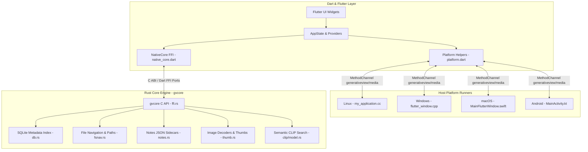

# Cross-Platform Architecture & Synchronization Guide

This guide details how **GenerativeView** maintains 100% feature parity across its four target operating systems: **Linux**, **Windows**, **macOS**, and **Android**.

Whenever you add a feature, refactor code, or introduce dependencies, consult this document to ensure your changes remain synchronized across all platforms.

---

## 1. System Architecture Overview

GenerativeView is structured into three cooperating tiers:



### Responsibility Breakdown

| Tier | Component | Responsibilities |
| :--- | :--- | :--- |
| **Dart / Flutter** (`lib/`) | UI & State Management | Responsive UI layouts (grid, panels, focus view), user interactions, keyboard shortcuts, undo/redo, search filters, remix editor. |
| **Native Host** (`linux/`, `windows/`, `macos/`, `android/`) | Platform Services (`generativeview/media`) | Native clipboard file operations (preserving generation metadata), OS trash / recycle bin, external URL browser launch, Android video frame decoding fallback. |
| **Rust Core** (`core/`) | `gvcore` Engine | Multi-threaded folder scanning, SQLite caching, metadata extraction (PNG chunks, EXIF, WebP, ComfyUI, InvokeAI, A1111/Forge), thumbnail generation, TinyCLIP embeddings, natural sorting, and atomic `.generativeview.json` sidecar writes. |

---

## 2. Cross-Platform Discrepancies & Parity Solutions

### 2.1 File Paths and Normalization

Paths are exchanged continuously between Rust (`core/`), SQLite (`dirs.path`), Dart models (`MediaItem.path`), and OS file watchers (`notify` / `INotify` / `ReadDirectoryChangesW` / `FSEvents`).

#### The Canonical Path Standard
**All paths in GenerativeView must be normalized to forward slashes (`/`), with uppercased Windows drive letters, stripped macOS private prefixes, and no trailing slash (except root directories).**

| OS | Raw OS Representation | Canonical GenerativeView Form |
| :--- | :--- | :--- |
| **Windows** | `d:\pictures\image.png` | `D:/pictures/image.png` |
| **Windows Verbatim** | `\\?\C:\Users\foo\file.png` | `C:/Users/foo/file.png` |
| **Windows UNC** | `\\?\UNC\server\share\file.png` | `//server/share/file.png` |
| **Windows Drive Root** | `C:\` or `c:` | `C:/` (trailing slash preserved) |
| **macOS Symlinked Temp** | `/private/var/folders/.../img.png` | `/var/folders/.../img.png` |
| **macOS Symlinked Tmp** | `/private/tmp/.../img.png` | `/tmp/.../img.png` |
| **Linux / Android** | `/home/user/Pictures/img.png` | `/home/user/Pictures/img.png` |
| **Unix Root** | `/` | `/` (single slash preserved) |

#### Dual Implementation
Normalization logic is implemented in both Rust and Dart and must remain identical:
- **Rust:** `fsnav::normalize_path` in [`core/src/fsnav.rs`](file:///home/jrufer/Development/GenerativeView/core/src/fsnav.rs).
- **Dart:** `normalizePath` in [`lib/src/core/models.dart`](file:///home/jrufer/Development/GenerativeView/lib/src/core/models.dart).

#### Rules for Developers
1. **Never use `path.join` or `Platform.pathSeparator`** to build internal media paths. Always use `joinMediaPath(dir, name)` in `lib/src/core/models.dart`.
2. **Always normalize before comparison:** When matching event roots (`e['root']`) with state paths (`state.folder`), or checking `pinnedFolders.contains(path)`, wrap both sides in `normalizePath(...)`.
3. **Keep Drive Roots Intact:** A Windows drive root like `C:/` must retain its trailing slash so Win32 APIs and Rust `Path::new("C:/").is_dir()` evaluate it as a drive directory rather than the current working directory on drive C.

---

### 2.2 Root Directories and Volume Discovery

Each OS exposes mount points and storage volumes differently. [`core/src/fsnav.rs:roots()`](file:///home/jrufer/Development/GenerativeView/core/src/fsnav.rs) handles this conditionally:

```
roots()
 ├── Android:
 │    ├── Internal storage: /storage/emulated/0 (Pictures, DCIM, Download, Documents)
 │    └── Removable SD cards: /storage/XXXX-XXXX
 ├── Desktop Home:
 │    └── HOME (Linux/macOS) or USERPROFILE (Windows fallback)
 │         └── Pictures, Downloads, Documents, Desktop, ComfyUI, InvokeAI, A1111/Forge
 ├── Windows Volumes:
 │    └── Enumerates A:/ through Z:/ via Path::new("X:/").is_dir()
 ├── macOS Volumes:
 │    ├── Scans /Volumes/ (skips hidden entries and symlink /Volumes/Macintosh HD -> /)
 │    └── "File system" (/)
 └── Linux Volumes:
      ├── Parses /proc/mounts (/run/media/, /media/, /mnt/)
      └── "File system" (/)
```

#### Hidden and System Folders
In folder browsing ([`core/src/fsnav.rs:list_dirs()`](file:///home/jrufer/Development/GenerativeView/core/src/fsnav.rs)):
- Dot-prefixed folders (`.git`, `.cache`, etc.) are hidden across all platforms.
- Windows-specific system entries (`$RECYCLE.BIN`, `System Volume Information`) are filtered by name on all platforms.
- On Windows, `FILE_ATTRIBUTE_SYSTEM` is queried via `std::os::windows::fs::MetadataExt::file_attributes()` and excluded.

---

### 2.3 Time Zone & Civil Calendar Math

GenerativeView displays date groupings and calendar timelines without heavy external time dependencies.

#### The Problem
- POSIX systems (`Linux`, `macOS`, `Android`) provide reentrant `localtime_r(&secs, &mut tm)` and `tzset()`.
- Windows MSVC CRT (`ucrtbase`) does **not** provide `localtime_r` or `tzset`. Instead, it provides `_tzset()` and `localtime_s(tm: *mut tm, time: *const time_t)` (with reversed parameter order).
- Crucially, Windows `localtime_s` **aborts/asserts** if given a negative `time_t` (dates before 1970).

#### The Solution ([`core/src/dates.rs`](file:///home/jrufer/Development/GenerativeView/core/src/dates.rs))
```rust
#[cfg(unix)]
fn local_tm(secs: libc::time_t) -> Option<libc::tm> {
    let mut tm: libc::tm = unsafe { std::mem::zeroed() };
    let ok = unsafe { !libc::localtime_r(&secs, &mut tm).is_null() };
    ok.then_some(tm)
}

#[cfg(windows)]
fn local_tm(secs: libc::time_t) -> Option<libc::tm> {
    if secs < 0 { return None; } // Guard pre-1970 from MSVC CRT assert
    let mut tm: libc::tm = unsafe { std::mem::zeroed() };
    let ok = unsafe { localtime_s(&mut tm, &secs) == 0 };
    ok.then_some(tm)
}
```
If `local_tm` returns `None` (pre-1970 or CRT failure), `local_day(ms)` gracefully falls back to deterministic civil division (`ms.div_euclid(86_400_000)`).

---

### 2.4 Low-Level File I/O & File Locking

#### CLIP Model File Reads (`core/src/clip/model.rs`)
The semantic search model reads exact byte ranges from disk concurrently:
- **Unix:** Uses `std::os::unix::fs::FileExt::read_exact_at(&self, buf, offset)`.
- **Windows:** MSVC lacks `std::os::unix::fs::FileExt`. Windows provides `std::os::windows::fs::FileExt::seek_read`, which can perform short reads. A custom `FileExt` trait wraps `seek_read` in a loop handling buffer advances and `Interrupted` errors.

#### Atomic Sidecar Writes & Windows File Locks (`core/src/notes.rs`)
Ratings, flags, and collections are saved in `.generativeview.json` beside the images:
1. The app writes to a temporary file (`.generativeview.json.<pid>.tmp`).
2. It renames the temp file over `.generativeview.json`.
3. **Windows Gotcha:** On Windows, file watchers (`notify` / `ReadDirectoryChangesW`), the Windows Search Indexer, or antivirus scanners frequently hold read handles on `.generativeview.json` without `FILE_SHARE_DELETE`. Calling `std::fs::rename` yields `PermissionDenied` or `ERROR_SHARING_VIOLATION` (OS error 32).
4. **Resolution:** `write_atomic` implements a 4-attempt retry loop with a 15ms backoff and a fallback target removal step.

---

### 2.5 Native Host Method Channel (`generativeview/media`)

Platform-specific OS integration is handled via the `generativeview/media` Flutter `MethodChannel`:

| Method | Linux (`my_application.cc`) | Windows (`flutter_window.cpp`) | macOS (`MainFlutterWindow.swift`) | Android (`MainActivity.kt`) |
| :--- | :--- | :--- | :--- | :--- |
| **`copyFile`** | GTK clipboard with `text/uri-list`, `x-special/gnome-copied-files`, and direct image bytes. | Win32 `OpenClipboard` with `CF_HDROP` (`DROPFILES`) holding UTF-16 backslash paths. | `NSPasteboard.general` with `[NSURL(fileURLWithPath:)]`. | `ClipData.newUri` via `CopiedFileProvider` content URI. |
| **`readCopiedFile`** | Reads GTK clipboard target bytes. | Reads file path from `CF_HDROP` or DIB/PNG clipboard bytes. | Reads `[NSURL]` file bytes or `NSPasteboard` PNG/TIFF data. | Reads content URI stream via `ContentResolver`. |
| **`pasteSource`** | Returns `{'path': String}` or `{'bytes': Uint8List, 'type': String}`. | Checks `CF_HDROP` path first, then `PNG` / `CF_DIB` image bytes. | Checks `[NSURL]` path first, then PNG / TIFF image bytes. | Reads ClipData URI path or image stream. |
| **`trashFile`** | `g_file_trash(g_file_new_for_path)` | `SHFileOperationW` with `FO_DELETE` and `FOF_ALLOWUNDO`. | `FileManager.default.trashItem(at:resultingItemURL:)`. | `MediaStore.createTrashRequest` (Android 11+) with system prompt. |
| **`openUrl`** | `xdg-open <url>` | `rundll32 url.dll,FileProtocolHandler <url>` | `open <url>` | Android `Intent(ACTION_VIEW, Uri.parse(url))` |
| **`videoFrame`** | Handled natively by Rust core / libmpv. | Handled natively by Rust core / libmpv. | Handled natively by Rust core / libmpv. | Hardware `MediaMetadataRetriever.getFrameAtTime(0)` fallback. |

---

### 2.6 User Experience & Interaction Parity

| Feature | macOS | Windows / Linux | Android |
| :--- | :--- | :--- | :--- |
| **Primary Modifier Key** | `Cmd` (`isMetaPressed`) | `Ctrl` (`isControlPressed`) | `Ctrl` (hardware keyboard) |
| **Trash Confirmation** | App asks first | App asks first | OS MediaStore prompt asks (`trashAsksFirst = true`) |
| **Storage Permissions** | Unrestricted (App Sandbox off) | Unrestricted | `Permission.manageExternalStorage` / `storage` |
| **Directory Polling** | 15,000 ms fallback | 15,000 ms fallback | 3,000 ms (Android storage drops notifications) |
| **Decoded Thumb Budget** | 384 MB | 384 MB | 160 MB |
| **Decoded Image Budget** | 768 MB | 768 MB | 256 MB |
| **Window Layout** | Desktop window with min size | Desktop window with min size | Responsive drawer and bottom footer |

---

### 2.7 Dynamic Libraries and Video Backends

#### `gvcore` Shared Library Loading
`NativeCore.resolveLibraryPath()` in [`lib/src/core/native_core.dart`](file:///home/jrufer/Development/GenerativeView/lib/src/core/native_core.dart) resolves the binary:
1. If `GVCORE_LIB` environment variable is set, use it directly (for development and integration tests).
2. Otherwise:
   - **Windows:** `gvcore.dll` (installed to the application root by CMake).
   - **macOS:** `libgvcore.dylib` (copied to `Contents/Frameworks/` with `@executable_path/../Frameworks/libgvcore.dylib` rpath).
   - **Linux:** `libgvcore.so` (bundled in AppImage or alongside binary).
   - **Android:** `libgvcore.so` (placed in `android/app/src/main/jniLibs/{arm64-v8a,armeabi-v7a,x86_64}`).

#### Video Playback (`media_kit`)
- **Linux:** Requires system `libmpv.so.2` or the custom bundled AppImage via `tool/build-libmpv-bundle.sh`.
- **Windows:** Bundled automatically via `media_kit_libs_windows_video: ^1.0.11`.
- **macOS:** Bundled automatically via `media_kit_libs_macos_video: ^1.1.4`.
- **Android:** Bundled automatically via `media_kit_libs_android_video: ^1.2.6`.

---

## 3. Developer Synchronization Checklist

Follow this checklist whenever modifying code to avoid platform regressions:

### When changing the Rust Core (`core/`)
- [ ] **Cross-Platform Compilation:** Does it build on Linux (`cargo check`), Windows MSVC (`--target x86_64-pc-windows-msvc`), and macOS (`--target aarch64-apple-darwin` / `x86_64-apple-darwin`)?
- [ ] **No Unconditional POSIX `libc` Calls:** Avoid `libc::localtime_r`, `libc::tzset`, or Unix-only `FileExt` without `#[cfg(unix)]` and Windows equivalents.
- [ ] **Use `fsnav::normalize_path`:** Ensure any new path generation outputs normalized forward slashes.
- [ ] **Run Core Unit Tests:** `cargo test --manifest-path core/Cargo.toml`.

### When changing Dart Models or App State (`lib/`)
- [ ] **Normalize All Paths:** Any new path stored in state, written to settings, or checked in a `Set` must be passed through `normalizePath()`.
- [ ] **Use `isPrimaryShortcutModifier`:** In keyboard listeners, do not check `isControlPressed` directly; check `isPrimaryShortcutModifier(isControlPressed: ..., isMetaPressed: ...)`.
- [ ] **Mock MethodChannel Calls:** If adding or changing methods in `generativeview/media`, update `test/test_helper.dart` with mock responses so `flutter test` succeeds on headless CI.
- [ ] **Run Flutter Tests:** `flutter test`.

### When changing Host Platform Runners (`windows/`, `macos/`, `linux/`, `android/`)
- [ ] **All Four Platforms Updated:** If you add a MethodChannel call, implement handlers in all four runners:
  - `windows/runner/flutter_window.cpp`
  - `macos/Runner/MainFlutterWindow.swift`
  - `linux/runner/my_application.cc`
  - `android/app/src/main/kotlin/com/jrufer/generativeview/MainActivity.kt`
- [ ] **Windows C++ Compiler Flags:** Note that modern MSVC enforces strict deprecation warnings. If C++ plugins trigger coroutine errors, ensure `_SILENCE_EXPERIMENTAL_COROUTINE_DEPRECATION_WARNINGS` is maintained in `windows/CMakeLists.txt`.
- [ ] **macOS Universal Binary:** macOS release builds must bundle a universal `libgvcore.dylib` (both `x86_64` and `arm64`) generated via `lipo`.

---

## 4. CI/CD Workflow & Release Matrix

GitHub Actions workflow [`.github/workflows/build.yml`](file:///home/jrufer/Development/GenerativeView/.github/workflows/build.yml) verifies all targets on every push to `main`:

| Workflow Job | OS Runner | Key Steps | Output Artifact |
| :--- | :--- | :--- | :--- |
| **Rust core tests** | `ubuntu-latest` | `cargo test` on `core/` | — |
| **libmpv for AppImage** | `ubuntu-22.04` | Compiles libmpv + ffmpeg bundle | `libmpv-bundle` |
| **Linux app** | `ubuntu-latest` | Builds Flutter, tests (49/49), packages AppImage, tests thumbnail smoke test on Ubuntu 22.04 | `generativeview-linux-x64` |
| **macOS app** | `macos-latest` | Builds dual-target universal Rust core (`lipo`), tests (49/49), packages universal `.app` & `.zip` | `generativeview-macos-universal` |
| **Windows app** | `windows-latest` | Builds Windows Rust core, tests (49/49), builds release with MSVC, packages `.zip` | `generativeview-windows-x64` |
| **Android APK** | `ubuntu-latest` | Builds Rust for 3 ABIs (`cargo-ndk`), builds signed universal & per-ABI APKs | `generativeview-android` |
| **Android emulator test** | `ubuntu-latest` | Boots hardware-accelerated tablet AVD, executes integration tests | `emulator-screenshots` |
| **Publish release** | `ubuntu-latest` | Downloads artifacts from all jobs and publishes unified GitHub Release | Multi-platform GitHub Release |

---

## 5. Local Testing Commands

### Linux
```bash
cargo test --manifest-path core/Cargo.toml
cargo build --release --manifest-path core/Cargo.toml
GVCORE_LIB="$PWD/core/target/release/libgvcore.so" flutter test
flutter run -d linux
```

### Windows (PowerShell)
```powershell
cargo test --manifest-path core/Cargo.toml
cargo build --release --manifest-path core/Cargo.toml
$env:GVCORE_LIB = "$PWD\core\target\release\gvcore.dll"
flutter test
flutter run -d windows
```

### macOS
```bash
cargo test --manifest-path core/Cargo.toml
# Build universal binary:
rustup target add x86_64-apple-darwin aarch64-apple-darwin
cargo build --release --manifest-path core/Cargo.toml --target x86_64-apple-darwin
cargo build --release --manifest-path core/Cargo.toml --target aarch64-apple-darwin
lipo -create -output core/target/release/libgvcore.dylib \
  core/target/x86_64-apple-darwin/release/libgvcore.dylib \
  core/target/aarch64-apple-darwin/release/libgvcore.dylib

GVCORE_LIB="$PWD/core/target/release/libgvcore.dylib" flutter test
flutter run -d macos
```

### Android
```bash
rustup target add aarch64-linux-android armv7-linux-androideabi x86_64-linux-android
cargo install cargo-ndk
cargo ndk -t arm64-v8a -t armeabi-v7a -t x86_64 -o android/app/src/main/jniLibs \
  build --release --manifest-path core/Cargo.toml
flutter build apk --debug
```
